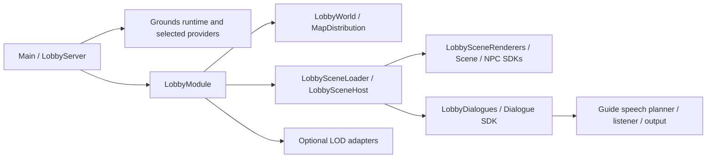

# Lobby architecture

This describes the current source at release 2.28.2. The application is a single Gradle project with Kotlin sources in `gg.grounds.minestom.lobby` and its `scene` package. Future feature-package proposals and separate Draft authored-dialogue work are not shipped structure.

## Source and responsibility map

Source links below use the existing packages rather than a proposed reorganization.

| Area                             | Source                                                                                                                                                                                                                                                                                       | Responsibility                                                                                                              |
| -------------------------------- | -------------------------------------------------------------------------------------------------------------------------------------------------------------------------------------------------------------------------------------------------------------------------------------------- | --------------------------------------------------------------------------------------------------------------------------- |
| Bootstrap and provider selection | [LobbyServer](../src/main/kotlin/gg/grounds/minestom/lobby/LobbyServer.kt), [Main](../src/main/kotlin/gg/grounds/minestom/lobby/Main.kt)                                                                                                                                                     | Configure runtime, install modules, select providers and enter application lifecycle                                        |
| Composition and shutdown         | [LobbyModule](../src/main/kotlin/gg/grounds/minestom/lobby/LobbyModule.kt)                                                                                                                                                                                                                   | Wire world, scene, dialogue and optional features; own readiness/admission and teardown order                               |
| World distribution               | [LobbyWorld](../src/main/kotlin/gg/grounds/minestom/lobby/LobbyWorld.kt), [MapDistribution](../src/main/kotlin/gg/grounds/minestom/lobby/MapDistribution.kt)                                                                                                                                 | Resolve CDN pin or local world, preserve loaded map identity, open world/spawn                                              |
| Scene preflight and ownership    | [LobbySceneLoader](../src/main/kotlin/gg/grounds/minestom/lobby/scene/LobbySceneLoader.kt), [LobbySceneHost](../src/main/kotlin/gg/grounds/minestom/lobby/scene/LobbySceneHost.kt)                                                                                                           | Validate sidecar/catalog/capabilities without entities; create runtime after ticks begin and own pending attachment cleanup |
| Scene rendering                  | [LobbySceneRenderers](../src/main/kotlin/gg/grounds/minestom/lobby/scene/LobbySceneRenderers.kt)                                                                                                                                                                                             | Adapt shared Scene/NPC rendering and viewer state                                                                           |
| Dialogue integration             | [LobbyDialogues](../src/main/kotlin/gg/grounds/minestom/lobby/scene/LobbyDialogues.kt), [LobbyDialogueBindings](../src/main/kotlin/gg/grounds/minestom/lobby/scene/LobbyDialogueBindings.kt)                                                                                                 | Bind built-in content, local sessions, menu actions, preferences and labels to the Dialogue host                            |
| Guide speech                     | [GuideSpeechPlanner](../src/main/kotlin/gg/grounds/minestom/lobby/scene/GuideSpeechPlanner.kt), [GuideSpeechProsody](../src/main/kotlin/gg/grounds/minestom/lobby/scene/GuideSpeechProsody.kt), [GuideSpeechOutput](../src/main/kotlin/gg/grounds/minestom/lobby/scene/GuideSpeechOutput.kt) | Plan voice boundaries/timing and own viewer-specific playback/private motion                                                |

Scene, NPC and Dialogue are already library integrations, not engines implemented by this application. [Build dependencies](../build.gradle.kts) are authoritative for versions; catalog-declared capabilities and selected renderers determine what a scene can use.

## Startup and resource ownership

`LobbyServer` disables Minestom's competing JVM shutdown hook before provider/configuration code can initialize it. Grounds owns the signal-driven shutdown sequence. `LobbyModule.install` prepares the world, validates the selected root `scene.json` and assembles dialogue/runtime requests before registering admission. Preflight creates no renderer entities. An absent sidecar permits immediate ordinary spawning; a malformed or unsupported selected sidecar fails startup.

Runtime creation starts after ticks begin. Player configuration waits for scene readiness with a bounded budget and rechecks the connection/closed state before assigning the spawning instance. Runtime creation failure denies admission and requests stop from a separate lifecycle thread. Scene identities include the loaded map address/version rather than just cached byte paths.

Shutdown closes admission first. Pending runtime/entity attachments and dialogue/private-output ownership must settle before scene cleanup is confirmed, then providers close in reverse order while Minestom ticks remain alive. A cleanup timeout/failure is reported as failure; it is not permission to claim resources were released. Follow the existing `LobbyModuleLifecycleTest`, `LobbySceneHostTest` and shutdown-process seams when changing this order.

## Scheduler, sessions and network scope

Minestom instance/tick scheduling owns entity/world mutations. Dialogue provides serialized session state and explicit asynchronous cleanup; asynchronous late acquisitions retain an owner and stale generations cannot publish to a replacement connection. The application retains the local `MinestomDialogueHost` and session state; player, instance and speaker objects are borrowed, not transferable live handles. Guide speech planning uses explicit clocks/callback seams; output additionally owns scheduled work and private NPC publication.

Network-wide identity, presence, permissions, routing, shared chat and durable delivery belong to their existing services/providers. A remote player must not be treated as connected to this server or proxy. Tests against local fixtures cannot establish real multi-proxy delivery or native-client acceptance.

## Configuration and documentation

Navigator, chat and settings providers are selected unconditionally; Agones, permissions, notifications and voice are gated by configuration. Notifications require permissions. Stage demo/private NPC inputs and LOD are separately gated. See [operations](operations.md) for exact inputs, map/pack handling and private distribution contracts, and [Contributing](../CONTRIBUTING.md) for the authenticated build boundary. Neutral local world use does not eliminate build artifact access.

[Historical plans](superpowers/plans) and [specifications](superpowers/specs) preserve decisions and measured results. They do not replace the current source or reopen waived acceptance scope. No map activation, pack publication or deployment follows from building the application.
